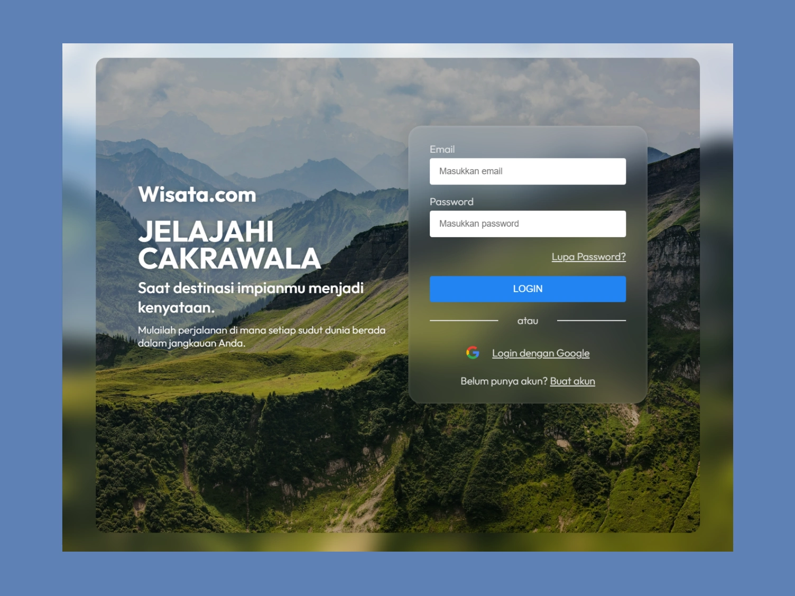

## Interactive Login Form With Validation

Developed a modern and responsive login interface for a travel website concept, featuring client-side form validation and interactive user feedback.

## Preview

## Features

- **Responsive UI** — Clean, translucent design optimized for desktop, tablet, and mobile devices.
- **Form Validation** — Client-side email and password validation using JavaScript.
- **Interactive Feedback** — Success notification with a 3-second auto-close timer.

## Demo Credentials

Use the following credentials to test the login form:

- **Email:** test123@gmail.com
- **Password:** KataSandi123

**Note:** This is a login simulation, not a real authentication system.

## Technologies

  

## Live Demo
[View Live Demo](https://ahmadmubarak1112.github.io/responsive-login-form/)